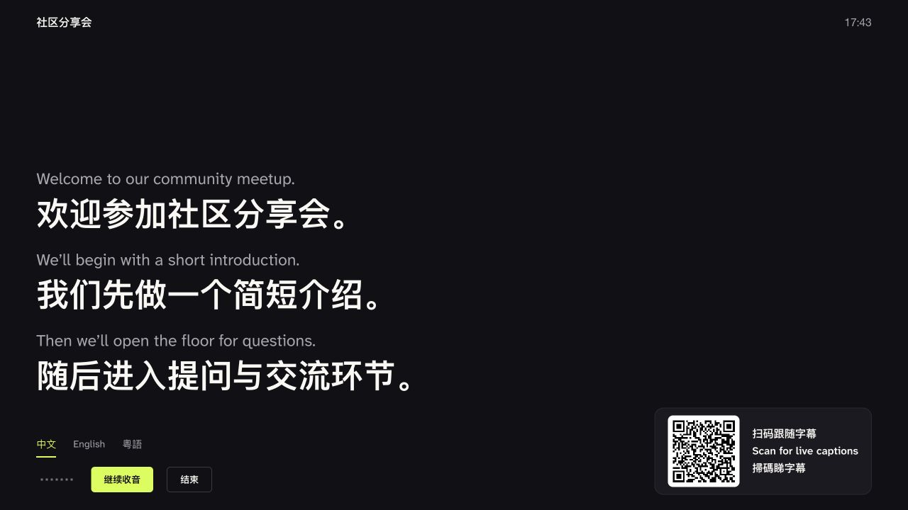
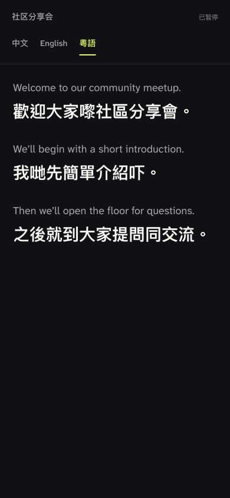

# Live Subtitles

[简体中文](README.md) · [English](README.en.md) · **繁體中文（香港）**

**一部電腦開啟同聲字幕，觀眾掃碼選擇自己的語言。**

CryoZeroLabs 項目 · [在 X 追蹤 @cryozerolabs](https://x.com/cryozerolabs)

精彩的分享，不該停在語言這一關。

當講者與聽眾使用不同的語言，聽眾需要跟上內容，講者需要保持節奏。Live Subtitles 為現場提供即時原文及譯文，字幕隨着講話逐句推進，觀眾透過手機也能參與同一場交流。

從現場大屏幕到手機屏幕，從即時字幕到會後錄音與 SRT，一場交流的內容可以被看見、被帶走、被繼續使用。

<p>
  
  
</p>

*現場大屏幕與手機同步跟隨，同一場交流，各自選擇語言。畫面內容為示例。*

## 轉換語言，交流繼續

講者還在往下說，聽眾卻可能仍在理解上一句。一個細節沒跟上，後面的背景、問題和判斷就容易接連錯過；等到會後補聽錄音，現場提問和一起確認的機會已經過去。

Live Subtitles 為討論加上一條持續更新的文字線索：原文保留表達，譯文幫助理解，字幕隨着講話逐句向上捲動。聽眾可以對照閱讀、重看上文，再回到最新內容，讓理解和討論同時發生。

技術分享、社群活動、跨語言會議，都可以把字幕帶進現場，讓使用不同語言的參與者跟上同一場討論。

## 一場活動，連接兩個屏幕

| 主辦單位的電腦 | 聽眾的手機 |
| --- | --- |
| 顯示原文及所選譯文，連接投影機或大屏幕即可供現場觀看 | 掃描會議二維碼，在瀏覽器直接開啟觀看頁 |
| 手動開始收音，按現場節奏暫停、繼續或結束 | 在中文、English、粵語之間直接切換 |
| 原文及譯文逐句成組向上捲動，未定稿內容在原位更新 | 各自選擇語言，重看上文或一鍵回到最新內容 |

主辦單位準備好一場會議，聽眾用自己的屏幕跟隨。手機與電腦連接同一個區域網絡，掃碼即可加入這場交流。

## 內容不會隨着散場結束

會議結束後，講話成為可以繼續使用的內容素材。

- **重溫討論**：在會議歷史中對照原文及譯文，找回當時的表達和上文下理。
- **帶走素材**：下載會議資料包，一次取得 WAV 錄音，以及原文、中文、英文、粵語四份 SRT。
- **繼續創作**：將錄音與字幕用於後續整理、剪輯及字幕製作，讓一場分享延伸為更多內容。

會議紀錄、錄音及字幕儲存在運行服務的電腦上，可在會議歷史中重看、下載及刪除。

## 模型由你選擇，會議由你掌握

Live Subtitles 透過 OpenAI 兼容 API 連接語音識別及字幕翻譯服務。你可以為兩項功能分別選擇模型，也可以共用同一組服務連線，配合自己的語言、活動和工作流程。

現時版本支援中文、英語及粵語。如需其他語言，可自行調整翻譯提示詞、語言選項及字幕輸出，並選用支援目標語言的模型。

在設定中分別填寫 **Base URL、API Key、模型**，翻譯服務亦可直接沿用識別服務的網址及 Key。Key 由本機後端管理，服務設定與會議內容分開儲存，切換模型也能沿用熟悉的字幕介面。

## 帶到你的下一場活動

準備 Node.js 20+、支援咪高峰及 AudioWorklet 的現代瀏覽器，以及可用的語音識別和文字翻譯服務。下載原始碼並進入項目目錄，執行：

```sh
npm ci
npm start
```

開啟 **[localhost:8090](http://localhost:8090)**，完成以下步驟：

1. 在「設定」中填寫識別及翻譯服務的 Base URL、API Key 與模型。
2. 建立會議，填寫名稱，進入字幕頁。
3. 按「開始收音」，允許使用咪高峰；按現場節奏暫停或繼續。
4. 讓聽眾連接同一個 Wi-Fi，掃碼開啟手機字幕，自行選擇語言。
5. 活動結束時確認儲存，在會議歷史中重溫內容，或下載錄音與 SRT。

## 文件與開源

技術文件（簡體中文）：[服務設定](docs/configuration.md) · [架構說明](docs/architecture.md) · [API 文件](docs/api.md)

項目以 MIT 授權開源，歡迎帶到自己的活動中使用，亦歡迎按實際場景繼續開發。

[MIT 開源授權](LICENSE) · [第三方授權](NOTICE.md)
